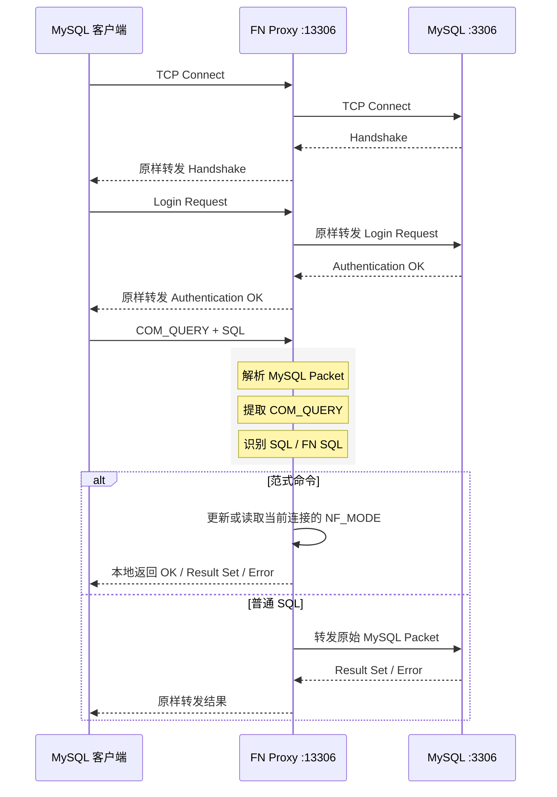

# FN-database

一个关于 MySQL 数据库的中间件，支持范式，需要用户手写依赖



## 范式相关 SQL 语法

当前正式项目使用 ANTLR4 4.13.2 识别以下自定义语句，关键字不区分大小写，末尾分号可选：

```sql
SET NF_MODE = 2NF;
SET NF_MODE = 3NF;
SET NF_MODE = BCNF;
SET NF_MODE = OFF;

SHOW NF_MODE;
```

代理会在本地处理这些命令，不再把它们转发给 MySQL：

- `SET NF_MODE = ...` 更新当前客户端连接的模式并返回 MySQL OK；
- `SHOW NF_MODE` 返回只有 `NF_MODE` 一列、一行的 MySQL Result Set；
- 每个客户端连接的初始模式都是 `OFF`，连接之间互不影响；
- 形似范式命令但语法错误的输入会返回 MySQL `1064 / SQLSTATE 42000`；
- 兼容 MySQL 8 客户端通过 `CLIENT_QUERY_ATTRIBUTES` 发送的空查询属性头；
- 普通 MySQL SQL 不进入 NF Parser，仍然透明转发给后端。

修改正式 grammar 后，在仓库根目录重新生成：

```bash
cd grammar
java -jar ../third_party/antlr-4.13.2-complete.jar \
  -Dlanguage=Cpp \
  -no-listener \
  -o ../generated \
  FNCommand.g4
cd ..
```

## 依赖与编译

Ubuntu / Debian：

```bash
sudo apt update
sudo apt install -y build-essential cmake libboost-system-dev

cmake -S . -B build
cmake --build build -j
```

生成的程序是 `build/fn_proxy`。

## 启动

使用默认配置（监听 `0.0.0.0:13306`，连接 `127.0.0.1:3306`）：

```bash
./build/fn_proxy
```

完整参数：

```bash
./build/fn_proxy \
  --listen-host 0.0.0.0 \
  --listen-port 13306 \
  --mysql-host 127.0.0.1 \
  --mysql-port 3306
```

查看帮助：

```bash
./build/fn_proxy --help
```

`--listen-host` 当前应为数字形式的 IPv4/IPv6 地址；`--mysql-host` 可以是 IP 或可解析的主机名。

## 使用真实 MySQL 测试

先确认 MySQL 正在 `127.0.0.1:3306` 监听，再通过代理连接：

```bash
mysql -h 127.0.0.1 -P 13306 -u root -p \
  --protocol=TCP --ssl-mode=DISABLED
```

当前代理只能在明文 MySQL Classic Protocol 中识别自定义 SQL，因此测试范式命令时必须关闭客户端 TLS，也不要启用 MySQL 压缩。TLS 或压缩连接仍可透明转发，但代理不会读取或处理其中的范式命令。

登录后可执行完整的读写测试：

```sql
SHOW DATABASES;
CREATE DATABASE fn_test;
USE fn_test;
CREATE TABLE users (id INT PRIMARY KEY, name VARCHAR(50));
INSERT INTO users VALUES (1, 'Alice');
SELECT * FROM users;
UPDATE users SET name = 'Bob' WHERE id = 1;
DELETE FROM users WHERE id = 1;
SHOW TABLES;
DROP DATABASE fn_test;
```

范式命令测试：

```sql
SHOW NF_MODE;
SET NF_MODE = 2NF;
SHOW NF_MODE;
SET NF_MODE = 3NF;
SET NF_MODE = BCNF;
SET NF_MODE = OFF;
```

普通 SQL 的行为应与直连 `3306` 相同。代理日志会显示连接建立、断开、本地处理的范式命令以及实际转发的字节数。

## 测试

```bash
ctest --test-dir build --output-on-failure
python3 tests/smoke_fake_mysql.py
```

冒烟测试会启动一个假的 MySQL 后端，验证普通 SQL 原样转发、范式命令不进入后端，以及 `SHOW NF_MODE` 返回当前连接的模式。

## 详细语法
一个函数依赖集定义为：`FDSET = (U, F)`，其中，`U`：逻辑属性全集，`F`：用户声明的函数依赖集合。

### 一、FDSET 生命周期

#### 1.1  FDSET 创建

##### 1.1.1 创建空函数依赖集

```sql
CREATE FDSET xxx;
```

##### 1.1.2 创建完整函数依赖集

```sql
CREATE FDSET xxx (
    ATTRIBUTES [A B C D E F G],
    DEFINE f1 [B] -> [C D],
    DEFINE f2 [D] -> [G]
);
```

其中：

- `ATTRIBUTES`：定义逻辑属性全集 `U`
- `DEFINE`：定义一条函数依赖
- `f1 / f2`：函数依赖名称
- `[B]`：决定因素
- `[C D]`：被决定属性

##### 1.1.3 匿名函数依赖

函数依赖名称可以省略：

```sql
CREATE FDSET xxx (
    ATTRIBUTES [A B C D E],
    DEFINE [A] -> [B C],
    DEFINE [C] -> [D]
);
```

系统自动生成名称：

```
f1
f2
```

自动生成的 FD 名称必须在当前 FDSET 中唯一。

#### 1.2 FDSET 删除与清空

##### 1.2.1 删除函数依赖集

删除整个 `FDSET`，包括属性全集、函数依赖和相关元数据。

```sql
DROP FDSET xxx;
```

如果该 `FDSET` 当前处于激活状态，应先执行：

```sql
DEACTIVATE FDSET;
```

##### 1.2.2 清空函数依赖

`TRUNCATE FDSET` 清空函数依赖及其 `ATTRIBUTES`。

```sql
TRUNCATE FDSET xxx;
```

### 二、FDSET 状态与查询

#### 2.1 FDSET 激活

##### 2.1.1 激活函数依赖集

```sql
ACTIVATE FDSET xxx;
```

一个数据库同一时间最多激活一个 `FDSET`。激活之后，`FN-DB` 使用该函数依赖集对后续关系模式进行检查。

##### 2.1.2 取消激活

```sql
DEACTIVATE FDSET;
```

#### 2.2 FDSET 查询

##### 2.2.1 查看指定 FDSET

```sql
SHOW FDSET xxx;
```

示例输出：

```
FDSET: xxx
ATTRIBUTES:
A B C D E F G
FUNCTIONAL DEPENDENCIES:
f1 : B -> C D
f2 : D -> G
```

##### 2.2.2 查看所有 FDSET

```sql
SHOW FDSET LIST;
```

示例：

```
NAME        STATUS
xxx         ACTIVE
yyy         INACTIVE
zzz         INACTIVE
```

##### 2.2.3 查看当前激活的 FDSET

```sql
SHOW FDSET ACTIVATED;
```

### 三、逻辑属性、函数依赖管理

#### 3.1 修改逻辑属性

##### 3.1.1 增加属性

```sql
ALTER FDSET xxx
ADD ATTRIBUTE H;
```

##### 3.1.2 删除属性

```sql
ALTER FDSET xxx
DROP ATTRIBUTE H;
```

如果属性 H 当前出现在函数依赖中，或被某个物理字段映射，则不允许直接删除。

##### 3.1.3 修改属性名称

```sql
ALTER FDSET xxx
RENAME ATTRIBUTE H TO I;
```

修改后，需要同步更新函数依赖中的属性名与物理字段映射关系。

#### 3.2 修改函数依赖

##### 3.2.1 添加命名函数依赖

```sql
ALTER FDSET xxx
ADD FD f3 [A] -> [E];
```

##### 3.2.2 添加匿名函数依赖

```sql
ALTER FDSET xxx
ADD FD [A] -> [E];
```

##### 3.2.3 删除函数依赖

```sql
ALTER FDSET xxx
DROP FD f3;
```

##### 3.2.4 修改函数依赖名称

```sql
ALTER FDSET xxx
RENAME FD f2 TO dependency_d_g;
```

##### 3.2.5 修改函数依赖内容

```sql
ALTER FDSET xxx
MODIFY FD f1 TO [B] -> [C];
```

#### 3.3 逻辑属性与物理字段映射

FN-DB 中 A、B、C、D ... 属于逻辑属性；MySQL 表中的列属于物理字段。

##### 3.3.1 CREATE TABLE 时映射

```sql
CREATE TABLE X (
    COL_A INT AUTO_INCREMENT PRIMARY KEY MAP TO A,
    COL_B INT MAP TO B,
    COL_C VARCHAR(10) MAP TO C,
    COL_D BOOLEAN MAP TO D,
    COL_G INT MAP TO G
);
```

FN-DB 内部记录：

```
X.COL_A -> A
X.COL_B -> B
X.COL_C -> C
X.COL_D -> D
X.COL_G -> G
```

##### 3.3.2 同名属性自动映射

如果物理字段名称与逻辑属性名称一致，可以省略 `MAP TO`：

```sql
CREATE TABLE X (
    A INT PRIMARY KEY,
    B INT,
    C VARCHAR(10),
    D BOOLEAN
);
```

如果当前激活的 FD_SET 中存在 A、B、C、D，则自动建立：

```
X.A -> A
X.B -> B
X.C -> C
X.D -> D
```

##### 3.3.3 多张表映射到同一个逻辑属性

```sql
CREATE TABLE X (
    COL_A INT PRIMARY KEY MAP TO A
);
CREATE TABLE Y (
    USER_A INT MAP TO A
);
```

此时：

```
X.COL_A -> A
Y.USER_A -> A
```

逻辑上二者都表示属性 A。

#### 3.4 已存在表的属性映射

##### 3.4.1 添加映射

```sql
ALTER MAPSET X ADD MAP COL_A TO A;
```

##### 3.4.2 解除映射

```sql
ALTER MAPSET X DROP MAP COL_A;
```

##### 3.4.3 修改映射

```sql
ALTER MAPSET X REMAP MAP COL_A TO B;
```

##### 3.4.4 查看表映射

```sql
SHOW MAPPSET X;
```

示例：

```
PHYSICAL COLUMN     LOGICAL ATTRIBUTE
COL_A               A
COL_B               B
COL_C               C
COL_D               D
```

#### 四、 范式模式

`FDSET` 激活状态与范式等级分开管理。

##### 4.1 开启 2NF

```sql
SET NF_MODE = 2NF;
```

##### 4.2 开启 3NF

```sql
SET NF_MODE = 3NF;
```

##### 4.3 开启 BCNF

```sql
SET NF_MODE = BCNF;
```

##### 4.4 关闭范式约束

```sql
SET NF_MODE = OFF;
```

##### 4.5 查看当前模式

```sql
SHOW NF_MODE;
```